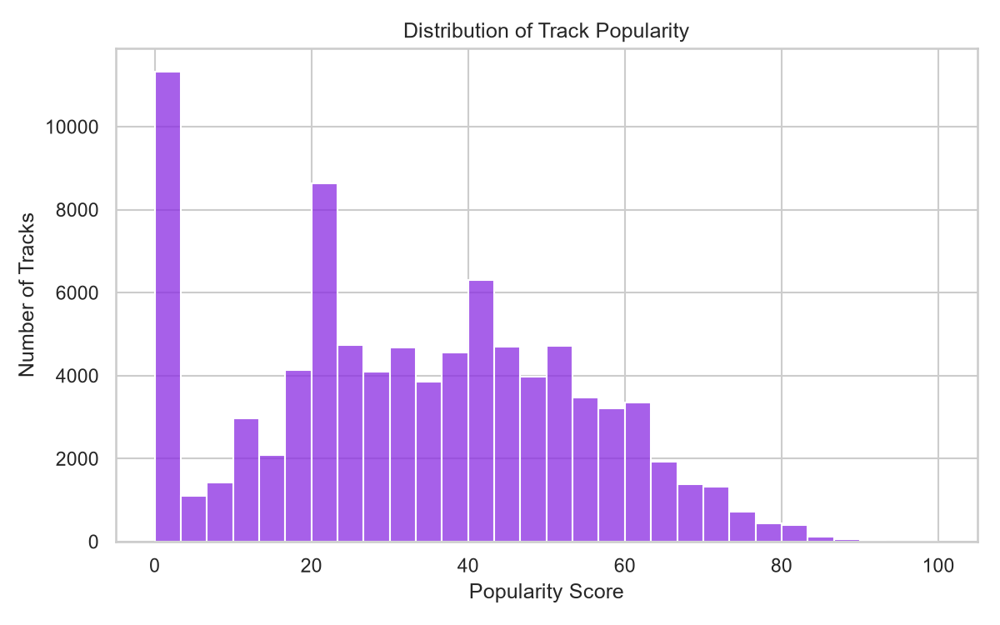
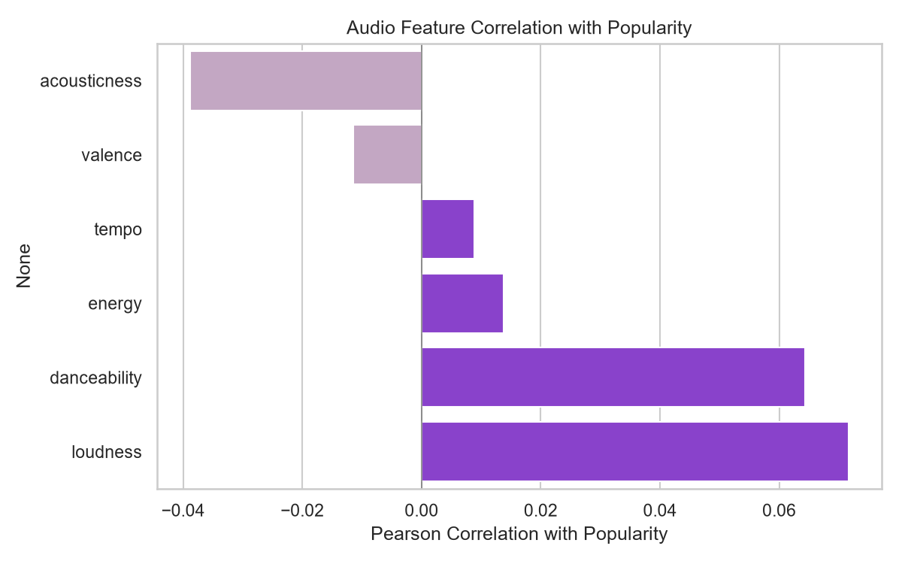
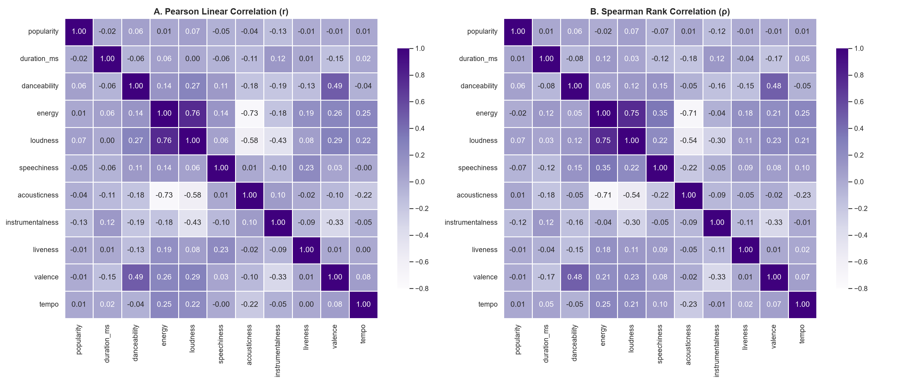
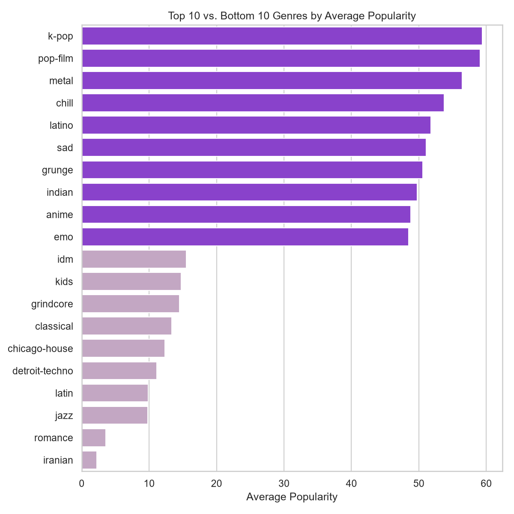
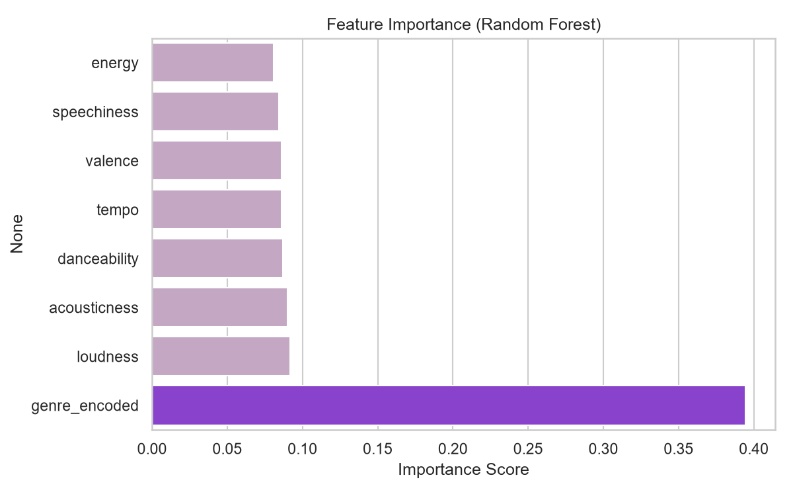

# Spotify Track Popularity Analysis

An end-to-end data science project that analyzes ~90,000 unique Spotify tracks to understand what drives song popularity, builds a model to predict it, and serves that model through a REST API.

> **Key finding:** genre explains popularity far better than any individual audio feature. Audio characteristics alone (danceability, tempo, energy, etc.) are weak predictors, while average popularity varies by roughly **57 points** across genres on a 0–100 scale.

## Table of Contents

- [The Question](#the-question)
- [Project Structure](#project-structure)
- [Data Source](#data-source)
- [Data Cleaning](#data-cleaning)
- [Key Findings (EDA)](#key-findings-eda)
- [Modeling](#modeling)
- [Error Analysis](#error-analysis)
- [Deployment (FastAPI)](#deployment-fastapi)
- [Limitations](#limitations)
- [How to Run](#how-to-run)
- [Tools Used](#tools-used)

## The Question

Can a song's popularity be predicted from its acoustic characteristics (danceability, tempo, energy, valence, loudness)? Or are other factors, such as genre, promotion, and cultural moment, doing most of the work?

## Project Structure

```
├── spotify_EDA_Modelling.ipynb          # Analysis: cleaning, EDA, modeling, error analysis
├── spotify_app_api_documentation.ipynb   # Documentation and tests for the API
├── app.py                            # FastAPI application
├── test_api.py                       # Smoke tests for the running API
├── requirements.txt                  # Python dependencies
├── figures/                          # Charts used in this README
├── dataset.csv                       # NOT in the repo: download from Kaggle (see below)
├── popularity_model.pkl              # NOT in the repo: generated by the analysis notebook
└── genre_means.pkl                   # NOT in the repo: generated by the analysis notebook
```

## Data Source

- **Dataset:** [Spotify Tracks Dataset](https://www.kaggle.com/datasets/maharshipandya/-spotify-tracks-dataset) (Kaggle, by Maharshi Pandya)
- **Size:** 114,000 rows and 21 columns, reduced to **89,740 unique tracks** after cleaning
- **Features:** popularity (target), duration, explicit flag, danceability, energy, key, loudness, mode, speechiness, acousticness, instrumentalness, liveness, valence, tempo, time signature, genre

## Data Cleaning

| Issue | Decision | Reasoning |
|---|---|---|
| 3 missing values (`artists`, `album_name`, `track_name`) | Dropped those 3 rows | Negligible volume, and text fields cannot be sensibly imputed. |
| 24,259 duplicate `track_id`s | Kept the first row per track | A song can be listed under several genres, creating repeated `track_id`s. Keeping one row per track means no song appears in both the training and test sets (no leakage). The trade-off is that the retained genre tag is arbitrary (see [Error Analysis](#error-analysis)). |
| 157 tracks with `tempo = 0` | Converted to `NaN`, kept the rows | These are genuine ambient and orchestral tracks where Spotify's beat detection could not find a steady tempo. This is a measurement gap, not a fake entry. Dropping the rows would discard the other valid features of each song. |
| 14 tracks under 30 seconds | Kept as-is | Verified as legitimate short classical movements (e.g. Mozart, Schumann). |
| 550 tracks over 10 minutes | Kept as-is | Verified as genuine long-form tracks from genres where long runtimes are standard (e.g. Afrobeat, progressive rock). |

## Key Findings (EDA)



Popularity is spread broadly around a center of about 33 (mean 33.2, median 33.0), with a spike at 0 (about 10% of tracks) and very few tracks at the top of the scale. The zero-popularity group is hard to separate from other tracks using audio data, which limits how well any model can predict exact values.

**Individual audio features correlate weakly with popularity**, all below 0.13 in absolute value:

| Feature | Correlation with popularity |
|---|---|
| Loudness | 0.072 |
| Danceability | 0.064 |
| Energy | 0.014 |
| Tempo | 0.009 |
| Valence | -0.012 |
| Acousticness | -0.039 |
| Instrumentalness | -0.127 |



Spearman (rank-based) correlations agree with Pearson, so the weak relationship is not an artefact of assuming linearity.

**Other observations**

- **Mode (major vs. minor)** shows a negligible difference in average popularity (33.6 vs. 32.9). **Explicit** tracks are about 4 points more popular on average (36.9 vs. 32.9), a small effect.
- **The strongest correlations are between audio features**, not with popularity. `energy` and `loudness` are strongly positively correlated, and `acousticness` is strongly negatively correlated with both.



**Genre is the dominant factor.** Average popularity by genre ranges from about 59 (k-pop, pop-film) down to about 2 (iranian), a spread of roughly 57 points that dwarfs every audio feature tested. Genre likely acts as a proxy for external factors such as K-pop's highly active fan-streaming culture and pop-film's built-in marketing tie-ins, rather than for acoustic properties.



## Modeling

All models are evaluated on the same held-out test set (20% of the data, 17,917 tracks, fixed random seed).

| Model | Features | R² | MAE | RMSE |
|---|---|---|---|---|
| Mean predictor (baseline) | None | 0.000 | 17.11 | 20.44 |
| Linear Regression | Audio features only | 0.017 | 16.78 | 20.26 |
| Linear Regression | Audio features + genre (mean-encoded) | 0.331 | 11.90 | 16.72 |
| **Random Forest** | Audio features + genre (mean-encoded) | **0.465** | **10.09** | **14.95** |

MAE and RMSE are in popularity points. The Random Forest cuts the average error from about 17 points (guessing the mean) to about 10.

Genre was encoded with **target (mean) encoding**: each genre is replaced by its average popularity, calculated on the **training set only** to prevent data leakage.

The Random Forest outperforms Linear Regression, suggesting non-linear and conditional relationships (for example, a feature's effect may depend on genre) that a straight-line model cannot capture. Feature importance confirms `genre_encoded` as the dominant predictor, at about 39% of total importance versus roughly 8–9% for each audio feature.



## Error Analysis

Beyond the overall R², I examined the predictions the model got most wrong to understand *why* it fails, not just *how often*.

**Finding:** 14 of the 15 largest errors are severe **under-estimates of mainstream hits** (e.g. "Ojitos Lindos" by Bad Bunny, "Gasolina" by Daddy Yankee, "BICHOTA" by KAROL G, "Thunder" by Imagine Dragons). Their actual popularity was 74–98, while the model predicted under 20. The remaining error is an over-estimate: a track with popularity 0 in a generally popular genre.

**Root cause:** these songs are tagged under multiple genres in the raw data. During deduplication, `drop_duplicates(keep="first")` kept whichever tag appeared first for each `track_id`, not necessarily the one most representative of the song's audience. A hit kept under a low-popularity tag (for example `latin`, whose average is only about 9) receives an artificially low genre-encoded value, which drags the whole prediction down even though the song is a genuine crossover hit.

**Takeaway:** this is a methodology limitation, not a modeling failure. A future improvement would be to encode genre using each song's *highest-popularity* tag, or to use multi-label genre features that keep every tag.

## Deployment (FastAPI)

The trained model is served through a **FastAPI** REST API (`app.py`), so it can be queried outside the notebook.

**How it works:** the API loads `popularity_model.pkl` (the trained Random Forest) and `genre_means.pkl` (the genre-to-average-popularity lookup). For each request it converts the genre name into its numeric value, builds the feature row in the order the model expects, and returns the prediction. If an unseen genre is passed, it falls back to the overall average popularity instead of failing.

| Method | Endpoint | Description |
|---|---|---|
| `GET` | `/` | Health check |
| `POST` | `/predict` | Returns the predicted popularity for one track |
| `GET` | `/docs` | Interactive documentation (Swagger UI) |

**Example request** (`POST /predict`):

```json
{
  "danceability": 0.7,
  "energy": 0.6,
  "loudness": -5.5,
  "valence": 0.5,
  "tempo": 120,
  "acousticness": 0.2,
  "speechiness": 0.05,
  "genre": "pop"
}
```

**Example response:**

```json
{
  "predicted_popularity": 67.82,
  "genre_used": "pop",
  "genre_encoded_value": 42.28
}
```

Inputs with a missing field or the wrong type are rejected with HTTP `422`. A full walkthrough, with tests, is in `spotify_api_documentation.ipynb`.

## Limitations

- **Moderate predictive power.** An R² of 0.465 means the model explains under half of popularity's variation. This is an expected ceiling: real-world popularity is driven by factors this dataset does not contain, such as marketing spend, artist fame, playlist placement, release timing, and viral moments. A model that predicted popularity near-perfectly from acoustic data alone would be suspicious, not impressive.
- **Arbitrary genre assignment.** Keeping the first genre tag per track causes the largest prediction errors (see [Error Analysis](#error-analysis)).
- **Single train/test split.** Reported metrics come from one split, with no cross-validation or confidence intervals.
- **Target encoding of 113 genres** can overfit rare genres, and no smoothing was applied.
- **API input validation is minimal.** It checks types but not value ranges, and genre matching is case-sensitive (`"K-Pop"` is treated as an unseen genre).

### Possible next steps

- Multi-label genre features, or a "highest-popularity tag" rule
- K-fold cross-validation and hyperparameter tuning
- Gradient-boosted trees (XGBoost, LightGBM) for comparison
- Artist-level features, with careful leakage control
- Range validation and genre normalization in the API

## How to Run

### 1. Setup

```bash
git clone <your-repo-url>
cd <your-repo-folder>
python -m venv .venv
.venv\Scripts\activate          # Windows (use: source .venv/bin/activate on macOS/Linux)
pip install -r requirements.txt
```

Download `dataset.csv` from [Kaggle](https://www.kaggle.com/datasets/maharshipandya/-spotify-tracks-dataset) and place it in the project folder.

### 2. Run the analysis

Open `spotify1_formatted.ipynb` in Jupyter or VS Code and run all cells. This produces the charts in `figures/` and saves `popularity_model.pkl` and `genre_means.pkl` in the project folder.

> The model file is about 500 MB, which exceeds GitHub's 100 MB file limit, so the `.pkl` files are excluded from the repository (see `.gitignore`). You must generate them by running the notebook.

### 3. Start the API

```bash
python -m uvicorn app:app --reload
```

Then open `http://127.0.0.1:8000/docs` to test `/predict` in the browser.

> **Windows tip:** if `uvicorn app:app` fails with "An Application Control policy has blocked this file", use `python -m uvicorn ...` as above, which starts the same server through Python.

### 4. Test the API

With the server running, in a second terminal:

```bash
python test_api.py
```

Expected: k-pop, metal, jazz, and iranian return decreasing predictions, an unknown genre returns the fallback value (about 33.9), and the two invalid requests return `422`.

> Use the same scikit-learn version to train and to serve the model. Pickled models can fail to load across versions.

## Tools Used

- Python, pandas, NumPy
- scikit-learn (`LinearRegression`, `RandomForestRegressor`, `train_test_split`)
- matplotlib and seaborn (visualization)
- joblib (model persistence)
- FastAPI, Pydantic, and Uvicorn (deployment)
- Jupyter Notebook

---

*This project was built as a learning exercise in end-to-end data analysis, from messy real-world data through cleaning, exploration, modeling, and deployment.*
